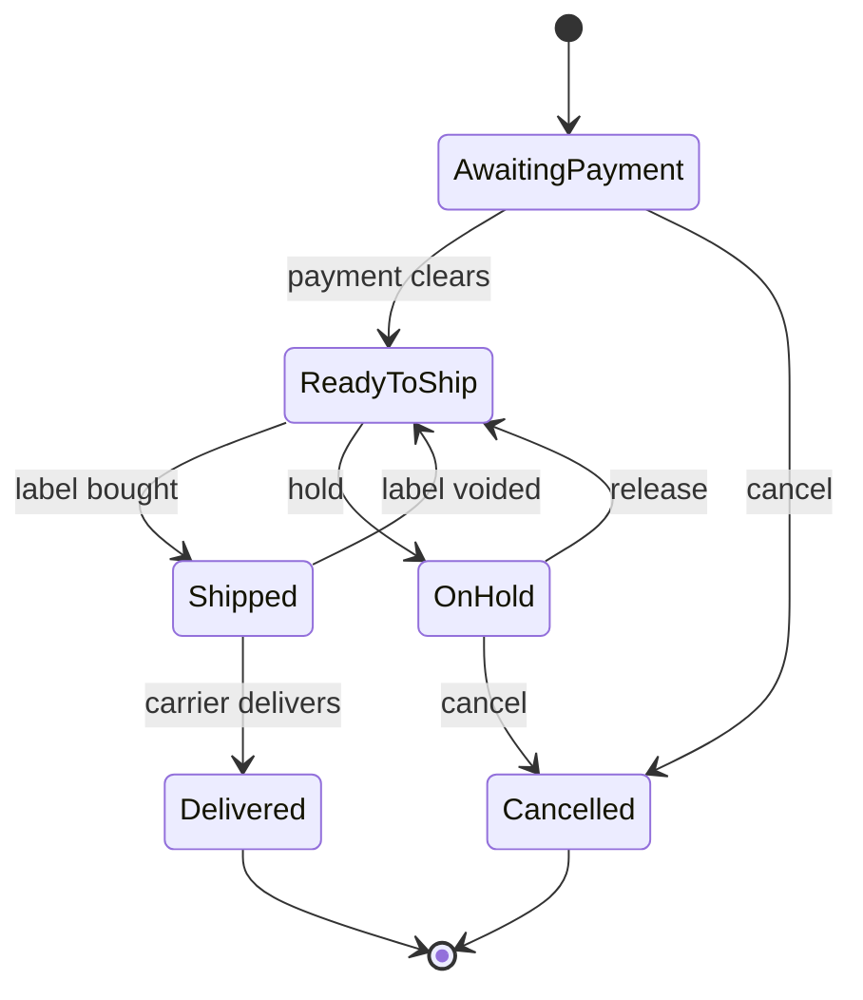

# SRS — Order Management Page

Version: 2026-11-14 · Source doc: https://claude.ai/artifact/LaqucQ61bTwC2QaTckWLwB

## 1. Introduction

This SRS covers the Orders page of our seller back office: one screen where staff see every order from every channel, choose a package and carrier rate, buy the label, and mark the order shipped. The design follows the Veeqo orders grid (screenshot supplied) and the OMS practices in Veeqo's guide.

### 1.1 Purpose

This document tells developers, testers and the store owner exactly what the Orders page must do. Each requirement has an ID (FR-xx, NFR-xx) so it can be traced to tasks and tests.

### 1.2 Scope

In scope for this release:

- Order list with status tabs (All, Ready to Ship, Shipped) and counts
- Search, filters, sorting and pagination
- Per-order shipping setup: ship-from location, package, carrier rate, ship date
- Buying labels one at a time and in bulk
- Tags, alerts, notes and order history
- Manual order creation and CSV import
- Order sync from sales channels and tracking push-back

Out of scope for now: picking and packing screens, returns handling, purchase orders, inventory forecasting, and reports. These are listed as later phases in section 9.

### 1.3 Definitions

| Term | Meaning |
| --- | --- |
| Order | A customer purchase imported from a channel or entered by hand |
| Shipment | One parcel sent for an order; an order can have more than one |
| Channel | Where the sale happened: our web store, Amazon, eBay, Walmart, TikTok Shop |
| Ship From | The warehouse or location the parcel leaves from |
| Rate | A carrier quote for one service, such as UPS Ground Saver at $8.28 |
| Label | The purchased carrier label with a tracking number |
| Overdue | An order past its dispatch-by date and not yet shipped |
| OMS | Order management system |
| SLA | The channel's promised ship-by date |

### 1.4 References

- [Veeqo order management system guide](https://www.veeqo.com/order-management-system-guide)
- Screenshot of the Veeqo Ready to Ship grid, supplied by the store owner
- [Veeqo help center](https://help.veeqo.com/en), for detail the guide does not give

## 2. Overall description

The Orders page is the daily work screen of the back office. It reads orders from the channel connectors and writes labels, tracking and status back to them.

### 2.1 Product perspective

The page belongs to the store's admin web app. It depends on four services: the order store (database), channel connectors, a carrier/rate service, and the inventory service. Section 7 lists the integrations.

### 2.2 User roles

| Role | Can do on the Orders page |
| --- | --- |
| Owner / Admin | Everything, including settings, refunds, cancelling and deleting orders |
| Shipping staff | View orders, edit package, choose rate, buy and void labels, add tags and notes |
| Customer service | View orders, edit address, add notes and tags, hold or cancel orders |
| Viewer | Read only; no label purchase, no edits |

### 2.3 Operating environment

- Desktop browsers: current Chrome, Edge, Firefox, Safari; designed for 1366 px wide screens and up
- Tablet and phone: list view and order detail must work; bulk label buying may be desktop only
- Label printers: 4×6 in thermal (PDF or ZPL) and plain A4/Letter PDF
- Time zone: shown in the store's time zone; stored in UTC

### 2.4 Assumptions and constraints

- Sellers ship mainly within the US with UPS, FedEx and USPS, as the screenshot shows
- Carrier accounts and API keys are set up in Settings, not on this page
- Weights in lb/oz and sizes in inches by default; metric is a store setting
- Currency is USD by default; the store's currency is a setting
- One store owner account at launch; more staff accounts added later

## 3. Order list page layout

The page has five bands from top to bottom: status tabs, search bar, active filter chips, toolbar, and the order grid. Every row is one order and can be shipped without opening it.

### 3.1 Status tabs (top bar)

- Tabs: **All**, **Ready To Ship**, **Shipped**, plus optional saved views (Awaiting Payment, On Hold, Cancelled, Returns)
- Each tab shows its live count, for example All 51,647, Ready To Ship 98, Shipped 47,239
- The active tab is highlighted; its "…" menu lets the user rename, reorder or save the current filters as a view
- A "…" menu at the far right holds page settings and export

### 3.2 Search and actions bar

- **Filters** button opens a filter panel (section 4.3)
- One search box: order number, customer name, email, zip code, product name, SKU or tracking number
- **Import** button: upload orders from CSV
- **New order** button: create a manual order

### 3.3 Active filter chips

- Each active filter shows as a chip, such as "Status: Ready to Ship", with a dropdown to change it
- **Clear all** removes every filter

### 3.4 Toolbar

- **Actions** dropdown for bulk actions on selected rows (section 4.6)
- Refresh button to re-sync and reload
- Column settings (gear): show, hide and reorder columns; saved per user
- Result count, such as "10 shipments"
- Pagination: first, previous, page box "1 / 10", next, last; page size 10, 25, 50, 100 or 250

### 3.5 Grid columns

| # | Column | Shows | Inline action |
| --- | --- | --- | --- |
| 1 | Select | Checkbox; header box selects all on the page | Select for bulk action |
| 2 | Alert | Warning icon for problems (address not verified, missing weight, out of stock, high-value) | Hover shows the reason |
| 3 | Channel | Logo of the sales channel | Hover shows channel name |
| 4 | Order | Status badge, order number as a link, order date and time | Click opens order detail; sortable |
| 5 | Customer | Name, city and state | Click opens customer card; sortable |
| 6 | Ship From | Warehouse or location | Dropdown to change |
| 7 | Package | Weight (lb oz), size (L × W × H in), package name | Dropdown to pick a saved package or type values |
| 8 | Shipping Rates | Carrier logo, service name, price, saving vs list rate in green | Dropdown lists all quotes, cheapest first |
| 9 | Email | Envelope icon: send tracking email on ship | Toggle |
| 10 | Ship Date | "Today" or a date | Date picker; sortable |
| 11 | Due | Badge such as **Overdue**, Due today, Due tomorrow | Sortable by dispatch-by date |
| 12 | Delivery | Service the customer chose, such as Free Economy | Read only |
| 13 | Total | Payment badge (Paid, Pending, Refunded) and order total | Sortable |
| 14 | Items | Product thumbnail, quantity badge, product name | Dropdown lists all line items |
| 15 | Tags | Coloured tags | "+" adds a tag |
| 16 | Actions | **Buy label** button and a menu | Menu: Print, Hold, Split, Merge, Mark shipped, Cancel |

The Actions column stays fixed on the right while the grid scrolls sideways.

### 3.6 Row states

- Rows with an alert show the warning icon and a soft highlight
- A row being processed shows a spinner on Buy label and blocks double clicks
- After a label is bought the button changes to **Print label** and the badge to Shipped

## 4. Functional requirements

Requirements are numbered FR-xx. **Must** = needed for launch; **Should** = launch if time allows; **Could** = later.

### 4.1 Order intake

| ID | Requirement | Priority |
| --- | --- | --- |
| FR-01 | The system shall import new and changed orders from each connected channel every 5 minutes and on demand (Refresh). | Must |
| FR-02 | The system shall not create duplicates: channel + channel order ID is unique. | Must |
| FR-03 | Users shall create a manual order with customer, address, items, prices, shipping method and payment state. | Must |
| FR-04 | Users shall import orders from CSV with a downloadable template, a preview, and a row-by-row error report. | Should |
| FR-05 | Imported orders shall keep the channel's dispatch-by and deliver-by dates. | Must |
| FR-06 | Each order shall reserve stock for its items when it reaches Ready to Ship. | Must |

### 4.2 Search

| ID | Requirement | Priority |
| --- | --- | --- |
| FR-07 | One search box shall match order number, customer name, email, zip code, product name, SKU and tracking number. | Must |
| FR-08 | Search shall return results within 1 s for up to 500,000 orders and match partial words. | Must |
| FR-09 | Search shall run inside the active tab and filters. | Must |

### 4.3 Filters, sorting, views

| ID | Requirement | Priority |
| --- | --- | --- |
| FR-10 | Filters: status, channel, order date range, ship-by date, ship-from, carrier, service, delivery method, payment state, tags, country/state, item SKU, item count, total range, has alert. | Must |
| FR-11 | Active filters shall show as chips; each chip can be edited or removed; Clear all resets. | Must |
| FR-12 | Sorting by order number, customer, order date, ship date, due date and total, ascending or descending. | Must |
| FR-13 | Users shall save the current tab, filters, sort and columns as a named view. | Should |
| FR-14 | Filters, sort, page and search shall be kept in the URL so a view can be bookmarked or shared. | Should |

### 4.4 Shipping setup per order

| ID | Requirement | Priority |
| --- | --- | --- |
| FR-15 | Ship From shall default to the location set by rules, else the default warehouse; users can change it. | Must |
| FR-16 | Package weight shall default to the sum of product weights; size and box to the product's or rule's default package. | Must |
| FR-17 | Users shall pick a saved package or type weight and size; changing either re-fetches rates. | Must |
| FR-18 | The system shall fetch live quotes from all enabled carriers and services and list them cheapest first. | Must |
| FR-19 | The rate pre-selected shall be the cheapest one that meets the order's delivery promise; each shows price and saving. | Must |
| FR-20 | Ship Date defaults to today (or the next working day after the cutoff time); users can choose another date. | Must |
| FR-21 | A "send tracking email" toggle per order, default from settings. | Should |

### 4.5 Labels

| ID | Requirement | Priority |
| --- | --- | --- |
| FR-22 | **Buy label** shall buy the selected rate, save the label PDF and tracking number, and move the order to Shipped. | Must |
| FR-23 | Before buying, the system shall check the address, weight, size and rate are present and show a clear error if not. | Must |
| FR-24 | After buying, the label opens for printing in the user's chosen format (4×6 thermal or Letter/A4). | Must |
| FR-25 | Users shall void an unused label within the carrier's void window; the order returns to Ready to Ship. | Must |
| FR-26 | Tracking number and carrier shall be sent back to the sales channel within 5 minutes of purchase. | Must |
| FR-27 | Users shall mark an order shipped without buying a label (own carrier), entering carrier and tracking. | Must |
| FR-28 | Packing slip and invoice shall be printable per order and in bulk. | Should |

### 4.6 Bulk actions

| ID | Requirement | Priority |
| --- | --- | --- |
| FR-29 | Bulk actions on selected rows: Buy labels, Print labels, Print packing slips, Change ship-from, Change package, Change service, Set ship date, Add/remove tag, Hold, Mark shipped, Export CSV. | Must |
| FR-30 | Bulk label purchase shall run in the background, show progress, and report each order's success or failure. | Must |
| FR-31 | One failed order shall not stop the rest of a bulk run. | Must |
| FR-32 | Successful bulk labels shall be merged into one PDF for printing. | Must |
| FR-33 | Users can select all orders matching the filter, not just the current page, with a confirmation showing the count. | Should |

### 4.7 Order handling

| ID | Requirement | Priority |
| --- | --- | --- |
| FR-34 | Users shall put an order on hold with a reason and release it. | Must |
| FR-35 | Users shall cancel an order; cancellation is synced to the channel where the channel allows it. | Must |
| FR-36 | Users shall split an order into several shipments and merge orders to the same address. | Should |
| FR-37 | Users shall edit the shipping address; edits are checked with an address check service. | Must |
| FR-38 | Users shall add internal notes; notes show in the order detail and as an icon in the row. | Must |
| FR-39 | Users shall add, remove and create coloured tags from the row "+" or in bulk. | Must |

### 4.8 Alerts and due dates

| ID | Requirement | Priority |
| --- | --- | --- |
| FR-40 | The Due badge shall show Overdue (past dispatch-by), Due today, or Due in N days. | Must |
| FR-41 | An alert icon shall appear for: unverified address, missing weight, no rates returned, item out of stock, payment pending, P.O. box with a carrier that cannot deliver there. | Must |
| FR-42 | A banner on the Ready to Ship tab shall show the number of overdue orders and filter to them on click. | Should |

### 4.9 Order detail

| ID | Requirement | Priority |
| --- | --- | --- |
| FR-43 | Clicking an order number opens a detail panel or page with customer, addresses, items, payments, shipments, notes, tags and history. | Must |
| FR-44 | The history log shall record every change with user, time, old value and new value. | Must |

### 4.10 Automation rules

| ID | Requirement | Priority |
| --- | --- | --- |
| FR-45 | Admins shall create rules: when an order matches conditions (channel, SKU, weight, country, total, delivery method), set ship-from, package, service, tag or hold. | Should |
| FR-46 | Rules run on import, in the order the admin sets, and each change is written to the history log. | Should |

## 5. Order lifecycle and business rules

An order moves through six states. Only Ready to Ship orders can have a label bought, and only a voided label moves an order back.

Read left to right: payment clears, a label is bought, the carrier delivers. Hold and cancel are side exits.

### 5.1 Business rules

| ID | Rule |
| --- | --- |
| BR-01 | An order enters Ready to Ship only when payment is fully cleared (status Paid). |
| BR-02 | An order can be cancelled from Awaiting Payment, Ready to Ship or On Hold, but not after a label is bought; void the label first. |
| BR-03 | Shipped means at least one label is bought or the order is marked shipped by hand. A partly shipped order shows "Partially shipped" and stays in Ready to Ship for the rest. |
| BR-04 | Delivered is set from carrier tracking events. |
| BR-05 | Overdue = now is past dispatch_by and status is Ready to Ship or On Hold. |
| BR-06 | Stock is reserved at Ready to Ship, deducted at Shipped, and released on Cancelled. |
| BR-07 | Orders over a set value (default $500) get a high-value alert and need signature service. |
| BR-08 | Free shipping orders (Delivery = Free Economy) default to the cheapest rate that meets dispatch-by and deliver-by. |
| BR-09 | Every status change writes an Order Event with who, when, from and to. |

## 6. Data model

One Order has many Line Items and many Shipments; each Shipment has one Package and one chosen Rate. Money is stored in cents, weight in ounces, size in inches, times in UTC.

| Entity | Key fields |
| --- | --- |
| Order | id, channel_id, channel_order_id (unique per channel), order_number, status, payment_status, customer_id, ship_to_address_id, delivery_method, subtotal, shipping_paid, tax, discount, total, currency, ordered_at, dispatch_by, deliver_by, ship_from_location_id, hold_reason, created_at, updated_at |
| Line Item | id, order_id, product_id, variant_id, sku, title, image_url, quantity, unit_price, weight_oz, quantity_shipped |
| Customer | id, name, email, phone, default_address_id, order_count |
| Address | id, name, company, line1, line2, city, state, zip, country, phone, is_verified, is_residential |
| Location | id, name, address_id, is_default, cutoff_time |
| Package | id, name, length_in, width_in, height_in, empty_weight_oz, is_default |
| Shipment | id, order_id, location_id, package_id, weight_oz, length_in, width_in, height_in, carrier, service, rate_amount, list_rate_amount, ship_date, tracking_number, label_url, label_format, status (draft, purchased, voided, in_transit, delivered), purchased_by, purchased_at |
| Shipment Item | shipment_id, line_item_id, quantity |
| Rate Quote | id, shipment_id, carrier, service, amount, list_amount, est_delivery_date, expires_at |
| Tag | id, name, colour; Order–Tag link table |
| Note | id, order_id, user_id, body, created_at |
| Order Event | id, order_id, user_id or "system", type, old_value, new_value, created_at |
| Channel | id, type (web store, Amazon, eBay, Walmart, TikTok), name, credentials_ref, last_synced_at |
| Rule | id, name, priority, conditions (JSON), actions (JSON), is_active |

Indexes are needed on order_number, status, ordered_at, dispatch_by, customer email, zip, SKU and tracking_number to meet FR-08.

## 7. Integrations and API

The page talks only to our own backend API. The backend talks to sales channels and carriers, so keys never reach the browser.

### 7.1 External integrations

| System | Direction | Used for |
| --- | --- | --- |
| Own web store | In and out | New orders, status, tracking, cancellations (webhook + API) |
| Amazon (SP-API) | In and out | Orders, buyer address, ship-by dates; confirm shipment with tracking |
| eBay, Walmart, TikTok Shop | In and out | Same as Amazon; later phases |
| Carriers: UPS, FedEx, USPS | Out | Rates, labels, voids, tracking; direct or through one aggregator (EasyPost, Shippo or ShipStation API) |
| Address check | Out | Verify and correct addresses (carrier API or aggregator) |
| Email service | Out | Tracking and shipping emails to customers |

Choosing one rate aggregator is recommended for launch. It gives one API for all carriers, and direct carrier accounts can be added later.

### 7.2 Backend API for the page

| Method and path | Purpose |
| --- | --- |
| GET /orders?status=&q=&filters=&sort=&page=&page_size= | List orders with counts per tab |
| GET /orders/{id} | Order detail with items, shipments, notes, history |
| POST /orders | Create a manual order |
| POST /orders/import | Upload CSV; returns a job ID |
| PATCH /orders/{id} | Edit address, ship-from, hold, tags, notes |
| POST /orders/{id}/rates | Fetch quotes for the current package |
| POST /orders/{id}/labels | Buy a label for the chosen rate |
| POST /shipments/{id}/void | Void a label |
| POST /orders/{id}/mark-shipped | Mark shipped with own tracking |
| POST /orders/bulk | Bulk action; returns a job ID |
| GET /jobs/{id} | Progress and per-order results of a bulk or import job |
| POST /orders/sync | Pull new orders from channels now |

### 7.3 Error handling

- A carrier or channel timeout shall show a clear message on the row and allow retry; nothing is charged twice
- Label purchase uses an idempotency key per shipment so a retry cannot buy two labels
- Failed channel sync is retried with back-off and shown on a sync status indicator

## 8. Non-functional requirements

| ID | Area | Requirement |
| --- | --- | --- |
| NFR-01 | Speed | The order list loads in under 2 s at 50 rows per page with 500,000 orders stored. |
| NFR-02 | Speed | Rates for one order return in under 3 s; a single label in under 5 s. |
| NFR-03 | Scale | Bulk label purchase handles 500 orders per job at 5 or more labels per second. |
| NFR-04 | Uptime | 99.5% monthly availability during working hours. |
| NFR-05 | Security | Login required; role-based access as in section 2.2; sessions expire after 12 hours idle. |
| NFR-06 | Security | Channel and carrier keys are encrypted at rest and never sent to the browser. |
| NFR-07 | Privacy | Customer addresses and emails are visible only to logged-in staff; exports are logged. Amazon buyer data follows Amazon's data protection policy, including deletion 30 days after shipment. |
| NFR-08 | Audit | Every change to an order, label purchase and void is written to the history log and kept 2 years. |
| NFR-09 | Reliability | No duplicate labels or duplicate orders (FR-02, idempotency in 7.3). |
| NFR-10 | Usability | Shipping one order from the Ready to Ship tab takes at most 2 clicks when defaults are correct. |
| NFR-11 | Usability | Keyboard: arrow keys move rows, Space selects, / focuses search. |
| NFR-12 | Accessibility | WCAG 2.1 AA: contrast, labels on icons, screen reader names for badges. |
| NFR-13 | Responsive | Grid works at 1366 px and up; under 768 px rows become cards with the key fields and a Buy label button. |
| NFR-14 | Backup | Daily database backup, kept 30 days; restore tested every quarter. |

## 9. Acceptance, phases and open questions

### 9.1 Acceptance criteria

- [ ] A new Amazon order appears in Ready to Ship within 5 minutes, with the correct ship-by date and no duplicate on re-sync
- [ ] Searching a SKU, zip code or tracking number finds the order in under 1 s
- [ ] Changing the package weight refreshes the rate list and pre-selects the cheapest rate that meets the delivery promise
- [ ] Buy label returns a printable 4×6 label, moves the order to Shipped, and the channel shows the tracking number within 5 minutes
- [ ] Bulk buying 100 labels finishes with one merged PDF and a report naming any failed orders and why
- [ ] Clicking Buy label twice buys only one label
- [ ] Voiding a label returns the order to Ready to Ship and logs the void
- [ ] An order past its dispatch-by date shows the Overdue badge
- [ ] A Viewer cannot buy labels or edit orders
- [ ] Every edit appears in the order's history with user and time

### 9.2 Release phases

1. **Phase 1 — Launch:** all Must requirements; web store and Amazon; one rate aggregator; single warehouse
2. **Phase 2:** Should requirements — saved views, automation rules, split/merge, CSV import, select-all-matching
3. **Phase 3:** picking and packing with barcode scan, returns (return labels, restock, refund), more channels, multi-warehouse routing, reports

### 9.3 Open questions

- Which store platform is the own web store built on, and does it send order webhooks?
- Which rate aggregator: EasyPost, Shippo or ShipStation API?
- Do we need USPS at launch, or only UPS and FedEx?
- How many staff accounts are needed at launch, and with which roles?
- Should the Ready to Ship tab hold orders whose payment is still pending, or send them to an Awaiting Payment tab?
